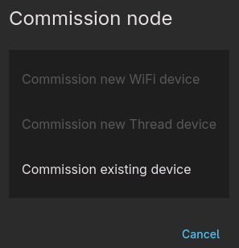

Because ESPHome already provides Wi-Fi or Thread credentials, commissioning works differently from most Matter devices.

After flashing the device, a commission code is generated and shown (SetupQRCode) while the commissioning window is open. Copy this code or click the link and scan the QR-code. Until the device is commissioned the same code is shown on every boot, so it survives power cycles (see [Passcode storage](#passcode-storage)).

```
[I][matter.commissioning]: Commissioning window open. SetupQRCode: MT:Y.K904QI14-O992WI00
[I][matter.commissioning]: QR URL: https://project-chip.github.io/connectedhomeip/qrcode.html?data=MT:Y.K904QI14-O992WI00
[I][matter.commissioning]: Manual pairing code: 32552014321
```

If you missed it, reboot the device while it is not commissioned: it shows the same code again.

## Setup codes in Home Assistant

Setup codes are logged while a commissioning window is open (see above). To read them
 through the [native ESPHome API](https://esphome.io/components/api/), add a
Matter text sensor:

```yaml
text_sensor:
  - platform: matter
    qr_code: # QR code formatted as MT:xxxxxxxxxxxxxxxxxxx
      name: "Matter QR-code string"
    manual_pairing_code: # Pairing code formatted as 0000-000-0000
      name: "Matter manual pairing code"
    commissioning_state: # uncommissioned | commissioning | window_open | commissioned
      name: "Matter commissioning state"
    fabric_count:
      name: "Matter fabric count"
    fabric_1:
      compressed_fabric_id:
        name: "Matter fabric 1 compressed ID"
      fabric_id:
        name: "Matter fabric 1 ID"
      label:
        name: "Matter fabric 1 label"
      node_id:
        name: "Matter fabric 1 node ID"
      vendor_id:
        name: "Matter fabric 1 vendor ID"
```

Each of these accepts the standard [text sensor options](https://esphome.io/components/text_sensor/)
and default to the diagnostic entity category. Values remain available when
Home Assistant reconnects. A code value does not indicate whether the
commissioning window is open; see [Persistence](#persistence) below.

Fabric slots `fabric_1` through `fabric_255` can each expose a `compressed_fabric_id`, `fabric_id`,
`label`, `node_id`, and `vendor_id` text sensor and are very useful for debugging commissioning issues.
Slots remain unknown while they have never contained a fabric. When an existing fabric is removed, its
slot is cleared. However, due to a limitation in the `text_sensor`, the values can't be set back to
unknown and becomes an empty string until after a restart.


# Commissioners

### matterjs-server / Home Assistant

To accept the dev DAC that esphome-matter uses, matterjs-server should be started with the `--enable-test-net-dcl` argument set to `true`;

`matterjs-server --enable-test-net-dcl=true`

Or the `ENABLE_TEST_NET_DCL` environment variable should be set to `true`.

For the Home Assistant Matter Server app, enable **Enable test-net DCL usage**
under **Settings → Apps → Matter Server → Configuration**. Save and restart
the Matter Server app to apply the setting.

When commissioning, use the "Commission existing device" option;



### python-matter-server

Accepts the dev DAC without any problems. But python-matter-server is discontinued and replaced by matterjs-server.

##### IKEA Dirigera

In the IKEA Home smart app, add the device by opening the QR url and scanning the code.

The IKEA system doesn't like it when a device has multiple endpoints. With the example config where a button, temperature sensor and light are configured, only the temperature sensor is shown in the app. If only the light endpoint is configured, it is detected correctly as a light.

# Persistence

The fabric data is stored on flash (nvs partition) and survives OTA updates. The fabric itself is independent of the hardware layer (wifi or thread). This means that it's even possible to commission a device over wifi and later substitute the wifi component with openthread (as long as the hardware supports both) and you don't need to re-commission!

## Passcode storage

`persist_passcode` controls where the plaintext passcode lives. The SPAKE2+ verifier, salt, iteration count and discriminator are always stored in flash (`chip-factory` NVS namespace). CHIP is given a custom `CommissionableDataProvider` that never returns the passcode, so it does not show up in CHIP's own boot logs.

| `persist_passcode` | Meaning |
| --- | --- |
| `until_commissioned` (default) | The passcode is stored in flash (`pin-code` key) only while the device has no fabric. The same QR/manual code is printed on every boot until the first commissioning. Then the key is erased and only the verifier remains. |
| `true` | The plaintext passcode stays in flash forever (a sticker that stays valid for the life of the device). |
| `false` | The passcode is only kept in RAM. Every boot of an uncommissioned device generates and shows a new code. |

```yaml
matter:
  expose: []
  persist_passcode: until_commissioned   # default; or true / false
```

This is how `until_commissioned` works in practice:

| Situation | Behaviour |
| --- | --- |
| First boot | A random passcode, discriminator, salt and verifier are generated and stored in flash. The code is printed to the log and published to the optional text sensors **while the commissioning window is open**, which on an uncommissioned device is on every boot. |
| Power cycle before commissioning | The stored passcode is loaded. The same code is shown again, so the one you copied still works. |
| First commissioning | When commissioning completes the plaintext passcode is erased from flash and RAM. Only the verifier remains. Nothing is printed on later boots. |
| Add another ecosystem | Use the "share"/"link" feature of the first ecosystem, or the `matter.open_commissioning_window` action. Both open a window with a fresh one-time passcode that is shown while the window is open. |
| Last fabric removed | The device becomes commissionable again with a freshly generated passcode, salt and discriminator, stored in flash until it is commissioned again. |
| Factory reset | A commissioned device creates a fresh identity on the next boot (the passcode was already erased). A device that was never commissioned keeps its stored code, as nothing was paired. `matter.reset_identity` always creates a new one. |
| Failed commissioning attempt | The code stays valid. You can retry with the same code. |
| `passcode:` set in YAML | The passcode is fixed, compiled into the firmware and shared by every device built from that YAML. It is always known, never written to flash, and printed whenever the window is open. Prefer the random passcode. |

Someone who dumps the flash of an uncommissioned device can read the passcode; once the device is commissioned they can only brute-force the verifier offline (the passcode has about 27 bits of entropy; physical access to the flash is out of scope for Matter's threat model).

### Upgrading from older firmware

Devices that already store a plaintext `pin-code` keep working: the salt, verifier and discriminator are reused, so existing fabrics and printed codes stay valid. On the first boot of the new firmware the `pin-code` key is erased from flash (with `persist_passcode: false`). With `until_commissioned` the key is kept while the device is uncommissioned and erased on boot if it already has a fabric. With `true` it is kept.

## Pairing info in logs, ESPHome and Home Assistant

The QR code and manual pairing code are logged when a commissioning window opens (on every boot while the device is uncommissioned, see above):

```
[I][matter.commissioning:...]: Commissioning window open. SetupQRCode: MT:Y.K904QI14-O992WI00
[I][matter.commissioning:...]: Manual pairing code: 32552014321
```

Optionally expose them as diagnostic text sensors (e.g. for the `web_server`, Home Assistant, or a `qr_code` on a display):

```yaml
text_sensor:
  - platform: matter
    commissioning_state:       # uncommissioned | commissioning | window_open | commissioned
      name: Matter state
    fabric_count:
      name: Matter fabrics
    manual_pairing_code:       # empty unless a window is open
      name: Matter pairing code
    qr_code:                   # empty unless a window is open
      name: Matter QR code
    fabric_1:                  # details of the first commissioned fabric
      label:
        name: Matter fabric 1 label
```

`manual_pairing_code` and `qr_code` are disabled by default (`disabled_by_default: true`) because they expose a secret while a window is open. Be careful with `web_server` (use `auth`) and with Home Assistant's recorder: the value is empty outside of commissioning, but state history keeps whatever was published.

## Automations

```yaml
matter:
  on_commissioned:      # a controller finished commissioning the device
    - logger.log: "Commissioned"
  on_decommissioned:    # the last fabric was removed
    - logger.log: "Decommissioned"
```

## Actions

```yaml
button:
  - platform: template
    name: "Matter: allow pairing"
    on_press:
      - matter.open_commissioning_window:
          timeout: 5min   # 3min to 15min
  - platform: template
    name: "Matter: remove from all ecosystems"
    entity_category: config
    on_press:
      - matter.factory_reset:
  - platform: template
    name: "Matter: reset identity"
    entity_category: config
    on_press:
      - matter.reset_identity:
```

- `matter.open_commissioning_window` opens a commissioning window for 3 to 15 minutes with a new random passcode, and logs/publishes it. On an uncommissioned device it re-opens the normal window instead.
- `matter.factory_reset` removes all fabrics: it clears the esp-matter data and the CHIP configuration, counters and key-value store (fabrics, ACLs, groups, ...) via the CHIP task and reboots. The discriminator is kept and after the reboot the device is commissionable again. Unless `persist_passcode: true` or a `passcode:` in the YAML is set, a commissioned device no longer knows its passcode, so a fresh passcode is generated on that boot and shown in the log.
- `matter.reset_identity` does the same and additionally erases the commissioning identity: a new passcode and discriminator are generated on the next boot. Previously printed codes become invalid. If `passcode:` or `discriminator:` are set in the YAML, those values are used again.

Neither action asks for confirmation. Put them behind something deliberate (a long button press, a config-category button).

# Multiple fabrics

Up to 5 fabrics are supported by default. To raise the limit use the `max_fabrics` option (5 to 254), see [device-info.md](device-info.md#fabric-limit):

```yaml
matter:
  max_fabrics: 8
```
